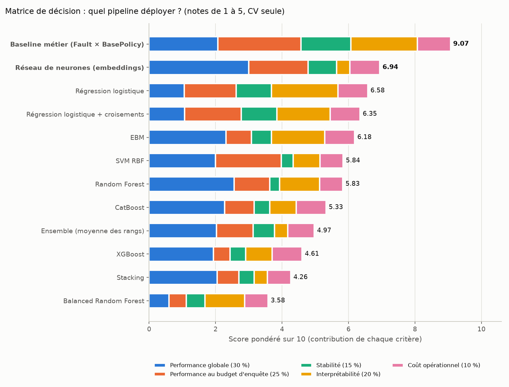

# Matrice de décision v2 — quel pipeline déployer ?

Généré par `src/decision_matrix.py` ; chaque note et chaque score sont aussi dans MLflow (expérience `fraud-bloc2-v2`, run `decision_matrix` `ed4e533ce74047599d50498f588ae33d`). Poids et règles de notation : `configs/decision_matrix_v2.yaml`, commités au commit `639ab81 du 2026-10-10`, **avant** ce calcul.

**Rôle.** Aide à la décision du bloc 4. Cette matrice ne remplace pas la sélection du bloc 2 : la règle pré-enregistrée a retenu Random Forest sur la CV seule. La matrice ajoute ce que la règle ignorait : l'interprétabilité, le coût et la performance au budget d'enquête.

**Notes de 1 à 5.** Performance globale (PR-AUC), performance au budget (rappel@10 %) et stabilité (écart-type de la PR-AUC entre folds) viennent de la **CV seule**, notées linéairement entre la pire et la meilleure ligne. L'interprétabilité suit l'ordre de simplicité pré-enregistré. Le coût est la moyenne de deux notes à seuils fixés d'avance (latence pour scorer 4,000 lignes brutes, taille du pipeline). Score sur 10 = 2 × Σ poids × note. Les chiffres de 1996 sont donnés pour information et n'entrent pas dans le score.

## Matrice

| Rang | Solution | Performance globale (30 %) | Performance au budget d'enquête (25 %) | Stabilité (15 %) | Interprétabilité (20 %) | Coût opérationnel (10 %) | Score / 10 | Rôle bloc 2 |
|---|---|---|---|---|---|---|---|---|
| 1 | **Baseline métier (Fault × BasePolicy)** | 3.4 | 5.0 | 5.0 | 5.0 | 5.0 | **9.07** |  |
| 2 | **Réseau de neurones (embeddings)** | 5.0 | 3.6 | 2.9 | 1.0 | 4.5 | **6.94** | meilleur en CV |
| 3 | Régression logistique | 1.8 | 3.1 | 3.5 | 5.0 | 4.5 | **6.58** |  |
| 4 | Régression logistique + croisements | 1.8 | 3.4 | 3.6 | 4.0 | 4.5 | **6.35** |  |
| 5 | EBM | 3.9 | 1.5 | 2.0 | 4.0 | 4.5 | **6.18** |  |
| 6 | SVM RBF | 3.3 | 4.0 | 1.2 | 2.0 | 3.5 | **5.84** |  |
| 7 | Random Forest | 4.3 | 2.1 | 1.0 | 3.0 | 3.5 | **5.83** | retenu par la règle (bloc 2) |
| 8 | CatBoost | 3.8 | 1.8 | 1.5 | 2.0 | 4.5 | **5.33** |  |
| 9 | Ensemble (moyenne des rangs) | 3.4 | 2.2 | 2.1 | 1.0 | 4.0 | **4.97** |  |
| 10 | XGBoost | 3.2 | 1.0 | 1.6 | 2.0 | 4.5 | **4.61** |  |
| 11 | Stacking | 3.4 | 1.3 | 1.5 | 1.0 | 3.5 | **4.26** |  |
| 12 | Balanced Random Forest | 1.0 | 1.0 | 1.9 | 3.0 | 3.5 | **3.58** |  |

## Valeurs mesurées

| Solution | PR-AUC CV | Rappel@10 % CV | Écart-type PR-AUC CV | Latence (s / lot) | Taille (Mo) | PR-AUC 1996 (info) | Rappel@10 % 1996 (info) |
|---|---|---|---|---|---|---|---|
| Baseline métier (Fault × BasePolicy) | 0.141 | 25.6 % | 0.023 | 0.004 | 0.0 | 0.105 [0.094 ; 0.124] | 23.5 % [17.8 ; 29.1] % |
| Réseau de neurones (embeddings) | 0.154 | 22.1 % | 0.047 | 0.128 | 1.0 | 0.128 [0.106 ; 0.168] | 19.7 % [15.0 ; 25.4] % |
| Régression logistique | 0.127 | 21.1 % | 0.040 | 0.122 | 0.0 | 0.100 [0.089 ; 0.121] | 16.0 % [11.7 ; 21.6] % |
| Régression logistique + croisements | 0.127 | 21.7 % | 0.039 | 0.125 | 0.0 | 0.100 [0.090 ; 0.121] | 16.0 % [11.3 ; 21.1] % |
| EBM | 0.144 | 17.2 % | 0.056 | 0.115 | 0.2 | 0.135 [0.109 ; 0.172] | 16.0 % [11.3 ; 21.1] % |
| SVM RBF | 0.140 | 23.1 % | 0.065 | 0.908 | 1.3 | 0.106 [0.090 ; 0.137] | 23.5 % [17.8 ; 28.6] % |
| Random Forest | 0.148 | 18.7 % | 0.068 | 0.327 | 35.3 | 0.137 [0.109 ; 0.176] | 19.2 % [14.1 ; 24.4] % |
| CatBoost | 0.144 | 17.8 % | 0.062 | 0.124 | 0.4 | 0.134 [0.108 ; 0.170] | 20.7 % [15.0 ; 25.8] % |
| Ensemble (moyenne des rangs) | 0.141 | 18.8 % | 0.055 | 0.148 | 1.8 | 0.136 [0.109 ; 0.173] | 17.8 % [13.1 ; 23.0] % |
| XGBoost | 0.139 | 15.9 % | 0.061 | 0.140 | 0.7 | 0.131 [0.105 ; 0.168] | 19.2 % [14.6 ; 24.9] % |
| Stacking | 0.141 | 16.6 % | 0.062 | 0.927 | 2.0 | 0.130 [0.105 ; 0.166] | 18.3 % [13.1 ; 23.9] % |
| Balanced Random Forest | 0.121 | 16.0 % | 0.058 | 0.309 | 37.8 | 0.131 [0.107 ; 0.169] | 22.5 % [16.9 ; 27.7] % |

## Sensibilité aux poids

14 jeux de poids : le jeu de base, 3 scénarios et chaque poids décalé de ±5 points.

| Solution | Dans le top 2 | Première |
|---|---|---|
| Baseline métier (Fault × BasePolicy) | 14 / 14 | 14 / 14 |
| Réseau de neurones (embeddings) | 10 / 14 | 0 / 14 |
| Régression logistique | 4 / 14 | 0 / 14 |

| Jeu de poids | 1er | 2e |
|---|---|---|
| base | Baseline métier (Fault × BasePolicy) | Réseau de neurones (embeddings) |
| performance_d_abord | Baseline métier (Fault × BasePolicy) | Réseau de neurones (embeddings) |
| interpretabilite_d_abord | Baseline métier (Fault × BasePolicy) | Régression logistique |
| poids_egaux | Baseline métier (Fault × BasePolicy) | Régression logistique |
| performance_plus_5pts | Baseline métier (Fault × BasePolicy) | Réseau de neurones (embeddings) |
| performance_moins_5pts | Baseline métier (Fault × BasePolicy) | Régression logistique |
| budget_plus_5pts | Baseline métier (Fault × BasePolicy) | Réseau de neurones (embeddings) |
| budget_moins_5pts | Baseline métier (Fault × BasePolicy) | Réseau de neurones (embeddings) |
| stability_plus_5pts | Baseline métier (Fault × BasePolicy) | Réseau de neurones (embeddings) |
| stability_moins_5pts | Baseline métier (Fault × BasePolicy) | Réseau de neurones (embeddings) |
| interpretability_plus_5pts | Baseline métier (Fault × BasePolicy) | Régression logistique |
| interpretability_moins_5pts | Baseline métier (Fault × BasePolicy) | Réseau de neurones (embeddings) |
| cost_plus_5pts | Baseline métier (Fault × BasePolicy) | Réseau de neurones (embeddings) |
| cost_moins_5pts | Baseline métier (Fault × BasePolicy) | Réseau de neurones (embeddings) |

## Constats
- Top 2 avec les poids de base → **Baseline métier (Fault × BasePolicy)** (9.07 / 10) puis **Réseau de neurones (embeddings)** (6.94 / 10).
- Robustesse → Baseline métier (Fault × BasePolicy) est dans le top 2 pour 14 jeux de poids sur 14, Réseau de neurones (embeddings) pour 10 sur 14.
- Modèle retenu par la règle du bloc 2 (Random Forest) → rang 7 sur 12, score 5.83 / 10.
- Conséquence → le bloc 4 part du pipeline retenu par la règle et compare ses décisions, au seuil du budget, à celles des solutions du top 2 ; la matrice ne re-sélectionne pas sur 1996.
